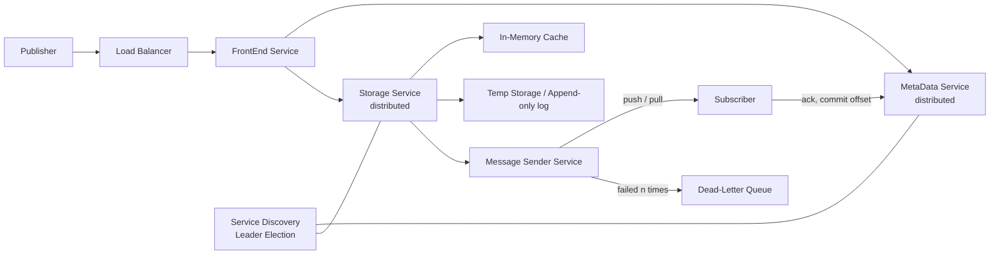

# 01 · Distributed Message Queue / Notification System

Source: `1_Notification_MessageQ.drawio` and the MQ section of `All.drawio`.

---

## 1. Requirements
### Functional
1. Producers `publish(id/key, topic, payload)`
2. Consumers `subscribe(topic, group)` and receive messages through `onMessage(payload)`
3. Ordering guaranteed **within a partition**
4. Configurable retention (time / size)
5. Consumer groups: each message goes to one consumer per group
6. Replay: consumers can re-read from an offset
7. *(Notification variant)* deliver to devices through push (APNs/FCM), SMS and email

### Non-Functional
1. Durability: no acknowledged message is lost
2. Availability
3. Scalability: millions of msgs/sec, horizontally partitioned
4. Low latency (ms-level end to end)
5. Configurable delivery semantics (at-most / at-least / effectively-once)

### Out of Scope
- Complex routing (AMQP exchanges), transactions across topics (mention only)

## 2. Capacity Estimate (example)
- 1M msgs/sec × 1 KB = ~1 GB/s ingest
- RF = 3 → 3 GB/s replicated writes
- 7-day retention → ~600 TB raw (before compression)

## 3. API
| API | Description |
|---|---|
| `publish(key, topic, payload, ack=0/1/all)` | Write a message; key picks the partition |
| `subscribe(topic, group)` | Join a consumer group |
| `poll(topic, maxMsgs, timeout)` | Pull a batch |
| `commit(topic, partition, offset)` | Commit the consumer's progress |
| `onMessage(payload)` | Push-style callback |

## 4. Data Model
- **Topic** → N **Partitions** → append-only **Segments** (log files + index)
- **Message**: `offset, key, value, timestamp, headers`
- **Metadata** (offsets): `(group, topic, partition) → committed offset`
- **Cluster metadata**: topic → partitions → leader broker, ISR list

## 5. High-Level Architecture

### Components
1. **Publisher / Producer**
   1. Batch messages (linger.ms, batch.size)
   2. Compress messages (snappy / lz4 / zstd)
   3. Choose the partition: `hash(key) % N`, round-robin when there's no key
   4. Ack levels: `ack=0` (fire and forget), `ack=1` (leader only), `ack=all` (all ISR, most durable)
2. **Load Balancer**: distributes producer connections
3. **FrontEnd Service**
   1. Request validation
   2. Authentication
   3. Authorization (topic ACLs)
   4. TLS termination
   5. Encryption
   6. Rate limiting / quotas
   7. Auditing
4. **MetaData Service (distributed)**
   1. Stores topic configs, partition → broker mapping, consumer offsets
   2. Backed by ZooKeeper / KRaft (Raft quorum)
5. **Service Discovery / Leader Election**: partition leader election, broker membership, heartbeat
6. **Storage Service (distributed brokers)**
   1. **Append-only log** on disk for throughput: sequential I/O
   2. Relies on the **OS page cache** to avoid JVM GC pauses
   3. Zero-copy (`sendfile`) to consumers
   4. **Partition + replica** (leader + followers)
   5. **In-sync replicas (ISR)**: followers caught up within `replica.lag.time.max.ms`
   6. **Consistent hashing** for partition placement
   7. **Partition rebalance** when brokers join or leave
   8. Storage engine: NoSQL-like segment files, sharding and replication
   9. Counting semaphore to cap concurrent access
7. **Message Sender Service**: delivers to subscribers; handles retry and dedup
8. **Subscriber / Consumer group**
9. **Dead-Letter Queue (DLQ)**: messages that failed n times, for later inspection or replay
10. **Push Notification** (notification design only): APNs / FCM / SMS / Email gateways

## 6. Deep Dives
### 6.1 Push vs Pull
1. **Push** (the default for notifications)
   - The consumer is notified as soon as a message is available; easier for the consumer
   - Can cause a hot-key problem (usage spike for a popular message)
   - Doesn't work or is expensive for offline consumers
   - The broker must track each consumer's speed to avoid overwhelming it
2. **Pull** (the celebrity solution: avoids massive load)
   - Simpler server implementation; the consumer does more work
   - Adds delay for online consumers (mitigate with long polling)
   - **Kafka chooses pull** because simpler broker logic outweighs the latency it adds; consumers control their own rate (natural back-pressure)
3. **Hybrid**: push by default; slow consumers fall back to pull

### 6.2 Delivery Semantics
1. **At-most-once**: commit the offset *before* processing; can lose messages
2. **At-least-once** (default, cheaper than dedup): retry and commit *after* processing; can duplicate
3. **Effectively-once** = consumer retry + idempotent processing (dedup table keyed by message ID, or upserts)
4. **Exactly-once (Kafka)**: idempotent producer (PID + sequence) + transactions (read-process-write atomically)

### 6.3 Retry & Failure Handling
1. Retry with exponential backoff + jitter
2. After n failures → DLQ
3. Ack / back-pressure signals to the producer
4. Commit the offset only after successful processing
5. Poison-pill detection (skip and DLQ)

### 6.4 Handling Hot Partitions
1. Regenerate the partition key (pick a better-distributed key)
2. Append a number 1–N to the key (salting); **this breaks ordering within that partition group**
3. Back-pressure / producer quotas
4. Add partitions (re-keys new data only)

### 6.5 Retention Policy
1. `retention.ms`: time-based
2. `retention.bytes`: size-based
3. Log compaction: keep the latest value per key (changelog topics)
4. Tiered storage: old segments move to S3

### 6.6 Consumer Group Rebalancing
1. At most 1 consumer per partition within a group; extra consumers stay idle
2. Rebalance triggers: a consumer joins or leaves, or misses a heartbeat
3. Eager (stop-the-world) vs cooperative/incremental rebalancing
4. Static membership reduces rebalances during rolling restarts

### 6.7 Ordering
1. Guaranteed only within a partition
2. Same key → same partition → ordered
3. Producer: `max.in.flight=1` or the idempotent producer keeps order on retry
4. Global ordering needs a single partition, which limits throughput

## 7. Notification System Specifics
1. **Flow**: service → Notification Service → validate and look up user prefs → MQ per channel → workers → APNs / FCM / SMS (Twilio) / Email (SES)
2. **Device token store**: `userId → [deviceToken, platform]`
3. **User preferences / opt-out**: per channel, quiet hours
4. **Templates**: localized, parameterized
5. **Priority queues**: OTP / critical vs marketing
6. **Dedup**: by notificationId within a time window
7. **Rate limit per user** so users aren't spammed
8. **Tracking**: sent, delivered, opened, clicked events → analytics
9. **Retry** third-party failures with backoff; drop expired notifications (TTL)

## 8. Bottlenecks & Trade-offs
| Concern | Option A | Option B |
|---|---|---|
| Durability vs latency | `ack=all` (safe, slower) | `ack=1` (fast, may lose) |
| Ordering vs throughput | 1 partition | many partitions (per-key order) |
| Delivery | at-least-once + idempotency | exactly-once transactions (costly) |
| Delivery model | push (low latency) | pull (consumer-paced) |

## 9. Monitoring
- Consumer lag per partition (the key metric)
- Under-replicated partitions, ISR shrink
- Produce / fetch latency, request rate
- DLQ size
- Disk usage vs retention
