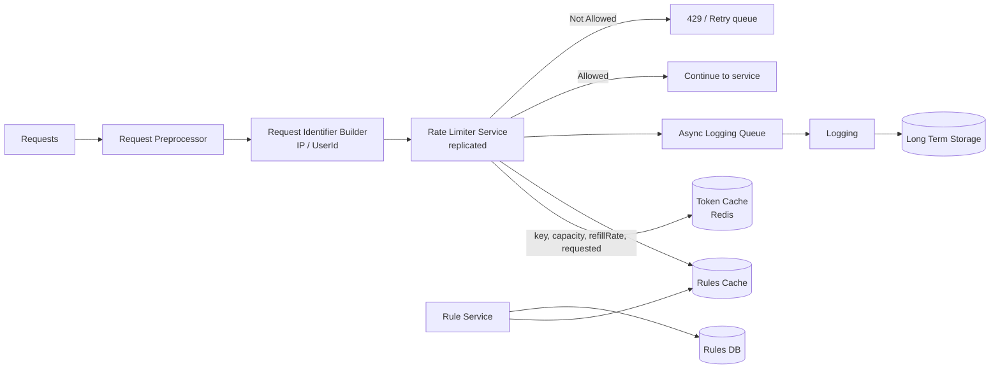

# 02 · Rate Limiter

Source: `2_RateLimiter.drawio` and the rate limiter section of `All.drawio`.

---

## 1. Requirements
### Functional
1. Limit requests per client identity (IP / userId / API key) per rule
2. Configurable rules (endpoint, tier, limit, window)
3. Reject over-limit requests with **429 Too Many Requests** + `Retry-After` header
4. Rules can be updated without redeploying

### Non-Functional
1. Very low latency (< 1–2 ms added)
2. Highly available (decide fail-open vs fail-close)
3. Distributed: consistent counts across many API servers
4. Accurate enough (small over-admission is acceptable)
5. Scales to millions of keys

## 2. Placement Options
1. **Client-side**: unreliable, can be bypassed
2. **Server-side** (this design): middleware in each service
3. **API Gateway / edge**: centralized; Envoy, Kong, AWS API GW
4. **Rate limiter as a service**, called by the gateway (this design)

## 3. API
```
allowRequest(request) -> { isAllowed, retryAfter, remaining }
// internal Token Cache call
consume(key, capacity, refillRate, requested) -> { isAllowed, retryAfter }
```

## 4. High-Level Architecture


### Components
1. **Request Preprocessor**: parses the request, extracts headers
2. **Request Identifier Builder**: builds the key from IP / userId / API key / endpoint
3. **Rate Limiter Service** (replicated, stateless)
   - `allowRequest(request)` → `isAllowed, retryAfter`
4. **Rules DB + Rules Cache + Rule Service**
   - Rule = (key pattern, refill rate, bucket size, window, tier)
   - **Push vs pull** rule propagation:
     - Push: Change Data Capture (e.g. Oracle GoldenGate) → invalidate the cache
     - Pull: refresh periodically
     - **Choose push** (faster propagation); pull as a backup
5. **Token Cache (Redis)**
   1. Shared across all limiter instances
   2. Atomic operations
   3. Sharded by ID: mod / consistent hashing
   4. Lazy refill (compute tokens on access from the last timestamp; no background refill job)
   5. Low TTL on keys (inactive keys expire)
6. **Async Logging Queue → Logging → Long Term Storage**: for analytics and abuse detection, off the hot path

## 5. Rate Limiting Algorithms
| # | Algorithm | Behavior | Pros | Cons |
|---|---|---|---|---|
| 1 | **Token Bucket** | Tokens refill at a rate; each request takes one | Allows bursts; memory-efficient | Two params to tune |
| 2 | **Leaky Bucket** | FIFO queue drained at a fixed rate | Stable output rate | Bursts delayed / dropped |
| 3 | **Sliding Window Log** | Store each request timestamp | Accurate | Memory heavy |
| 4 | **Sliding Window Counter** | Weighted current + previous window | Stable, cheap | Approximate |
| 5 | **Fixed Window Counter** | Counter per window | Simple | 2× burst at window edges |

### Token Bucket (Lua, atomic)
```lua
-- KEYS[1]=bucket  ARGV: capacity, refillRate(tokens/ms), now(ms), requested, ttl(ms)
local capacity, refillRate, now, requested, ttl =
  tonumber(ARGV[1]), tonumber(ARGV[2]), tonumber(ARGV[3]), tonumber(ARGV[4]), tonumber(ARGV[5])
local b = redis.call('HMGET', KEYS[1], 'tokens', 'ts')
local tokens = tonumber(b[1]) or capacity
local ts     = tonumber(b[2]) or now
tokens = math.min(capacity, tokens + (now - ts) * refillRate)   -- lazy refill
local allowed = tokens >= requested
if allowed then tokens = tokens - requested end
redis.call('HSET', KEYS[1], 'tokens', tokens, 'ts', now)
redis.call('PEXPIRE', KEYS[1], ttl)
return { allowed and 1 or 0, tokens }
```

## 6. Deep Dives
### 6.1 Race Conditions / Atomicity
1. Use a Redis counter + **Lua script** to make read-compute-write one command
   1. Solves the race and gives atomicity
   2. Batches operations, which makes it faster (one round trip)
2. Alternatives: `INCR` + `EXPIRE` (fixed window), sorted sets (sliding log)

### 6.2 Fail-Open vs Fail-Close
1. **Fail-open** for open / public APIs: availability over protection
2. **Fail-close** for sensitive APIs (login, payments, OTP)
3. Fallback: **local in-memory counter** if Redis is down (limit / N instances)

### 6.3 Handling Rejected Requests
1. **429 Too Many Requests** (fail fast) + `Retry-After` header
2. Retry queue: enqueue for later processing (async workloads)
3. Response headers: `X-RateLimit-Limit`, `X-RateLimit-Remaining`, `X-RateLimit-Reset`

### 6.4 Distributed Accuracy vs Latency
1. Centralized Redis: accurate; one network hop
2. Local counters + periodic sync: fast, approximate
3. Sticky routing (hash the key to a limiter node): local state, no Redis
4. Multi-region: per-region limits, or async cross-region sync

### 6.5 Hot Keys
1. A single abusive key hammers one Redis shard → local pre-filter / deny-list cache
2. Replicate the hot key's bucket, or split the limit across sub-keys

## 7. Bottlenecks & Trade-offs
- Redis is a dependency on every request → replicate (Sentinel/Cluster) and keep a local fallback
- Rule propagation lag vs consistency
- Granularity: per-user, per-IP (NAT issues), per-endpoint, global

## 8. Monitoring
- Allowed vs throttled counts per rule
- Limiter latency p99
- Redis errors and fail-open events
- Top throttled keys (abuse detection)
