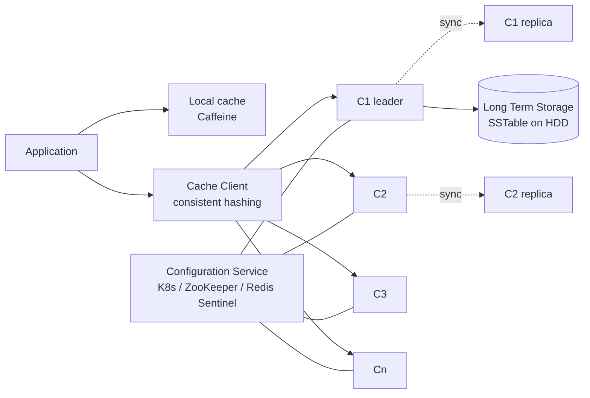

# 03 · Distributed Cache / Key-Value Store

Source: `3_Cache.drawio` and the distributed cache section of `All.drawio`. This design also covers the storage-engine notes (B-Tree, LSM, Cassandra, MongoDB).

---

## 1. Requirements
### Functional
1. `get(key)`
2. `put(key, val, ttl?)`
3. `evict(key)` / `delete(key)`
4. TTL-based expiration
5. Eviction when memory is full (LRU / LFU)

### Non-Functional
1. Low latency: sub-ms local, ~1 ms remote
2. High availability: replication and failover
3. Scalability: add or remove nodes with minimal rehashing
4. Tunable consistency: strong vs eventual
5. Durability is optional (cache) or required (datastore)

## 2. High-Level Architecture


### Components
1. **Application + local cache (Caffeine)**
   - Local / in-process cache with no network I/O cost
   - Risk: stale data across instances; keep the TTL short or broadcast invalidations
2. **Cache Client**
   - Owns the hash ring and routes `get/put/evict` to the right shard
   - **Consistent hashing** beats mod hashing: only a minimal set of keys is rehashed or rebalanced when a host is added or removed
   - Virtual nodes for even distribution
3. **Cache shards C1…Cn**, each with a leader + replicas (C1/R … Cn/R)
4. **Configuration Service** (K8s, ZooKeeper, Redis Sentinel)
   1. Leader election
   2. Service discovery (the shard list)
   3. Health / heartbeat monitoring
   - Versus a static configuration file on shared storage: the service automates list maintenance
5. **Long Term Storage**: SSTables on HDD (when the cache doubles as a datastore)

## 3. Caching Strategies
| Pattern | Read | Write | Notes |
|---|---|---|---|
| **Cache-aside** (lazy) | App reads cache → miss → DB → fill | App writes DB, invalidates cache | Most common |
| **Read-through** | Cache loads from DB on a miss | — | Cache library owns loading |
| **Write-through** | — | Write cache + DB synchronously | Consistent, slower writes |
| **Write-behind** | — | Write cache, flush to DB async | Fast, risk of loss |
| **Write-around** | — | Write DB only | Avoids cache churn |

## 4. Deep Dives
### 4.1 Expiration & Eviction
1. **Cache expiration (TTL)**: passive (on access) + active (sample and delete)
2. **Cache eviction**: LRU (hash map + doubly linked list), LFU, FIFO, random
3. **Soft vs hard delete**: tombstone/flag vs physical removal
4. TTL jitter so many keys don't expire together

### 4.2 Replication & Consistency
1. **Leader-follower**: writes go to the leader, async sync to replicas
2. **Leaderless** (Dynamo-style): any node accepts writes
3. **Quorum consensus**: `N` replicas, `W` write acks, `R` read acks; `R + W > N` gives strong consistency
4. **Strong vs eventual consistency**
5. **Sloppy quorum + hinted handoff**: write to a healthy stand-in node, hand off when the owner recovers
6. **Vector clocks**: detect concurrent writes; the client or app merges conflicts
7. **Last-write-wins (LWW)**: simple; vulnerable to clock drift

### 4.3 Cache Problems & Fixes
1. **Hot shard / hot key**
   - Local cache in front of the hot key
   - Replicate the hot key to multiple shards (`key#1..N`)
   - Read from replicas
2. **Cache stampede / thundering herd**: request coalescing (single-flight), lock on miss, early probabilistic refresh
3. **Cache penetration** (keys that don't exist): **Bloom filter** + negative caching
4. **Cache avalanche** (mass expiry): TTL jitter, multi-layer cache
5. **Stale data**: invalidate on write, CDC-driven invalidation

### 4.4 Multi-Layer Cache
1. L1: local (Caffeine): fastest, per instance
2. L2: remote (Redis / Memcached): shared
3. L3: CDN / edge for HTTP responses

### 4.5 Disaster Recovery
1. Snapshotting (Redis RDB)
2. Append-only log (Redis AOF)
3. Cross-region replication
4. Warm standby / restore from snapshot

### 4.6 Security
1. Firewall rules / private subnets
2. Authentication (Redis ACL / AUTH)
3. Encryption (TLS in transit, at rest)

### 4.7 Cache Annotation Ordering (Spring)
1. No cache: every request hits the source
2. `@CacheEvict` doesn't affect a `CacheGet` already in flight, and may run after it
3. `@CacheEvict` is thread-safe and runs after `CacheGet`
4. `@CachePut` runs after `CacheGet`
5. `CacheGet` runs after `CachePut` and sees the new value
6. A pre-warmed cache is unlikely to help when the TTL is low

## 5. Storage Engines
### 5.1 B-Tree (optimized for fast reads)
- Self-balancing, ordered, multi-level tree on **disk**
- **Write**: find the leaf page, update in place (WAL first), split pages when full
- **Read**: O(log n) page traversal, good for range scans
- Used by: MySQL InnoDB, PostgreSQL, MongoDB (WiredTiger)

### 5.2 LSM Tree: Log-Structured Merge Tree (optimized for fast writes)
- **Write**
  1. Write is appended to a WAL and buffered in memory (**memtable**)
  2. Memtable is sorted (balanced binary tree / skip list) and flushed to disk as an **SSTable**
  3. SSTables are compacted and merged (many small → few large)
  4. Deletion is implemented as a **tombstone**
- **Read**
  1. Search the memtable, then SSTables at every level
  2. Looking up a key that doesn't exist is expensive (checks every level)
  3. Because of #2, a **Bloom filter** is added at each level to give a firm "no"
- Compaction strategies: size-tiered (write-optimized) vs leveled (read-optimized)
- Used by: Cassandra, RocksDB, LevelDB, HBase

| | B-Tree | LSM |
|---|---|---|
| Writes | Random I/O, slower | Sequential, fast |
| Reads | Fast, predictable | Slower (multi-level) |
| Space amplification | Fragmentation | Until compaction |
| Write amplification | Page rewrites | Compaction |

### 5.3 Cassandra Cheat Sheet
1. **Partition key** (can be composite) → picks the node; **clustering key** → sort order within the partition
2. Keep related data on the same host to avoid cross-shard queries
3. Denormalized: one table per query pattern (vs normalization, which reduces redundancy)
4. **Read repair**: fix stale replicas during reads
5. **Anti-entropy**: background repair keeps replicas in sync and consistent
6. **Gossip protocol**: leaderless / decentralized membership; eventual consistency
7. **Merkle tree**: hierarchical structure where each node is a hash of a portion of the data; finds divergent ranges cheaply
8. **Hinted handoff**: eventual consistency
9. **LWW (last write wins)**: clock-drift risk
10. Row-level atomicity / lightweight transactions (Paxos); no full ACID transactions
11. No cross-partition sorting / joins
12. Tunable consistency: `ONE`, `QUORUM`, `LOCAL_QUORUM`, `ALL`

```sql
CREATE TABLE application_logs (
  id            INT,
  app_name      VARCHAR,
  hostname      VARCHAR,
  log_datetime  TIMESTAMP,
  env           VARCHAR,
  log_level     VARCHAR,
  log_message   TEXT,
  PRIMARY KEY ((app_name, env), hostname, log_datetime)
) WITH CLUSTERING ORDER BY (hostname ASC, log_datetime DESC);
```
- Partition = `(app_name, env)`; rows are sorted by host, newest logs first

### 5.4 MongoDB
1. Schemaless documents (BSON)
2. B-Tree indexes (WiredTiger)
3. Single-document atomicity; multi-document ACID transactions since 4.0, giving SQL-like consistency guarantees
4. Replica sets (primary + secondaries), sharding by shard key

## 6. Monitoring
- Hit ratio, miss ratio
- Eviction rate, memory usage
- p99 latency per shard
- Hot key detection
- Replication lag
