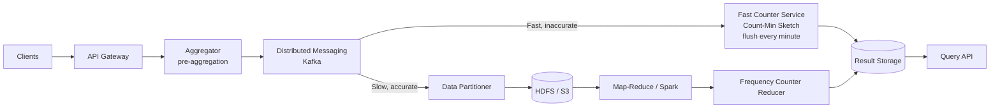

# 04 · Top-K / Heavy Hitters / Ad Click Aggregator

Source: `4_TopK.drawio` and the TopK section of `All.drawio`.

---

## 1. Requirements
### Clarifying Questions
1. How fast? (real-time seconds vs minutes vs hourly)
2. How accurate? (exact vs approximate is OK)
3. Top-K over what window? (1 min / 1 h / 1 day / all-time)
4. Raw vs aggregated data retention?
5. K size? (top 10 vs top 1000)

### Functional (Ad Click Aggregator)
1. Save every click
2. Query click count by `adId` over a time range (minute granularity)
3. Return top-K most-clicked ads per window
4. Redirect the user to the advertiser URL

### Non-Functional
1. Peak ~10k–1M clicks/sec
2. Low-latency queries (< 1 s)
3. Fault tolerant: no lost clicks (billing depends on it)
4. Idempotent: no double counting
5. Eventually accurate (reconciled)

## 2. Capacity Estimate (example)
- 1B clicks/day ≈ 12k/s avg, ~50k/s peak
- Raw event ~200 B → 200 GB/day raw
- Aggregates: (ads × minutes) is far smaller

## 3. API
```
POST /click {adId, userId, impressionId, ts}  -> 302 redirect
GET  /ads/{adId}/clicks?from=&to=&granularity=minute
GET  /ads/topk?k=10&window=1h
```

## 4. Architecture: Two Paths (Lambda style)


### Components
1. **API Gateway**: validates, authenticates and dedups clicks (impressionId)
2. **Aggregator (pre-aggregation)**
   1. Pre-aggregation greatly reduces the number of messages sent to Kafka
   2. Serializes data in a compact binary format (Avro / Protobuf), saving network I/O
   3. Con: loses the detail of individual events (keep a raw stream for audit)
   4. Frequency count hashtable decisions:
      - Aggregate or not?
      - Aggregate in memory or on disk?
      - Flush every minute or when full?
3. **Distributed messaging system (Kafka)**: durable buffer, partitioned by `adId`
4. **Fast path: Fast Counter Service** (fast, inaccurate)
   - **Count-Min Sketch**: a fixed-size table on each node
   - Probabilistic: stores an **upper bound** of the real count (overestimates only)
   - Plus a min-heap of size K for the current top-K
   - Flushes every minute to result storage
5. **Slow path: batch** (slow, accurate)
   - Data Partitioner → HDFS / S3 → Map-Reduce → Frequency Counter Reducer
   - Apache Spark: data partitioning + in-memory aggregation (batch) + top-K with a heap + reduce
6. **Result Storage**: SQL or NoSQL, stored by interval, replicated
7. **Periodic reconciliation**: batch results overwrite the fast-path approximations

## 5. Ad Aggregator Evolution
1. Separate read and write DBs
2. A cron scheduler runs Spark to aggregate the write DB into the read DB at minute granularity
   - **2+. Use Flink (streaming) instead of the cron job**
3. The ad placement service passes the **ad ID** instead of the full ad URL (server looks up the redirect URL; prevents tampering)
4. Periodic reconciliation between the stream and the batch / raw logs

## 6. Deep Dives
### 6.1 Approaches to Counting
| Approach | Accuracy | Memory | Notes |
|---|---|---|---|
| Single hashtable + heap | Exact | O(n) keys | Doesn't scale |
| In-memory aggregation, distributed | Exact | Expensive | Shuffle cost |
| **Data sampling** | Approximate | Low | Misses long tail |
| **Count-Min Sketch** + heap | Overestimates | Fixed (w × d) | Mergeable |
| Lossy Counting / Space-Saving / Misra-Gries | Approximate | O(1/ε) | Heavy hitters |
| Batch Map-Reduce | Exact | Disk | Slow |

### 6.2 Count-Min Sketch
1. `d` hash functions × `w` counters
2. Increment: `table[i][h_i(x)]++` for every i
3. Query: `min_i table[i][h_i(x)]`
4. Error ≤ ε·N with probability 1−δ, where `w = e/ε`, `d = ln(1/δ)`
5. Sketches are additive, so they merge across nodes and time windows

### 6.3 Stream Processing: Flink vs Spark
1. **Flink**: pure streaming (event by event), event-time windows, watermarks, exactly-once checkpoints
2. **Spark (Structured Streaming)**: mini-batching; higher latency, simpler

### 6.4 Windowing
1. Tumbling (fixed 1 min), sliding (5 min every 1 min), session windows
2. Event time vs processing time; **watermarks** for late events
3. Top-K over 1 h = merge 60 one-minute sketches/heaps

### 6.5 Stream Counter / Heavy Hitters
- Partition by key → local top-K per partition → global merge of the local top-Ks
- Caveat: a global top-K built from local top-Ks can miss items that are spread across partitions; partitioning by key avoids this

### 6.6 Exactly-Once / Idempotency
1. Dedup by `impressionId` / `clickId` at ingest (Redis SET with TTL)
2. Kafka idempotent producer + Flink checkpoints (two-phase commit sink)
3. Reconciliation catches residual drift

### 6.7 Scaling Concerns
1. Data replication
2. Partition rebalancing
3. **Hot shard problem**: a viral ad gets every click on one partition → salt the key (`adId#n`), then merge
4. Click fraud / bot filtering (rate limit per user/IP)

## 7. Data Model
- **Raw clicks** (S3 / Cassandra): `clickId, adId, userId, ts, ip, ua`
- **Aggregates**: `PK(adId, minute) → count`
- **TopK**: `PK(window, windowStart) → [(adId, count)...]`
- Use an OLAP store (Druid / Pinot / ClickHouse) for flexible slicing

## 8. Monitoring
- Kafka consumer lag
- Fast vs batch discrepancy %
- Late-event rate
- Dedup hit rate
