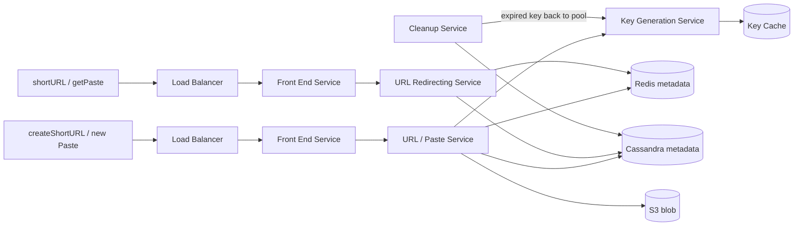

# 05 · TinyURL / PasteBin

Source: `5_TinyUrlPasteBin.drawio` and the ShortURL/PasteBin section of `All.drawio`.

---

## 1. Requirements
### Functional
1. `createShortURL(longUrl, customAlias?, expiry?)` / create a new paste
2. `GET /{shortUrl}` → redirect (301/302) / return the paste content
3. Optional custom alias
4. Expiration (default + user-defined)
5. Analytics (click counts), optional

### Non-Functional
1. Very read-heavy (100:1 R/W)
2. Low redirect latency (< 50 ms)
3. Highly available
4. Short URLs must be unpredictable (not sequential), optional
5. Unique short keys, no collisions

## 2. Capacity Estimate
- 100M new URLs/month ≈ 40 writes/s; reads ≈ 4k/s (peak 10–20k/s)
- 5 years → 6B URLs; base62 with 7 chars = 62^7 ≈ 3.5 trillion keys (plenty)
- URL record ~500 B → ~3 TB; pastes up to ~10 MB each → put them in S3

## 3. API
```
POST /urls   {longUrl, alias?, expireAt?} -> 201 Created {shortUrl}
GET  /{key}                              -> 301/302 Location: longUrl
POST /pastes {content, expireAt?}         -> 201 {pasteKey}
GET  /pastes/{key}                        -> 200 content
DELETE /urls/{key}
```

## 4. Data Model
- **URL table** (Cassandra / DynamoDB, KV access): `key (PK), longUrl, userId, createdAt, expireAt`
- **Paste**: metadata in Cassandra (`key, s3Path, size, expireAt`), content in **S3 (blob)**
- **User**: `userId, apiKey, tier`

## 5. High-Level Architecture


### Components
1. **Write path**: Load Balancer → Front End Service → URL/Paste Service → `201 Created`
2. **Read path**: Load Balancer → Front End Service → URL Redirecting Service → `301/302`
3. **Key Generation Service (KGS)** + **Key Cache**: pre-generates unique keys
4. **Redis**: metadata cache for hot URLs (LRU)
5. **Cassandra**: metadata store
6. **S3**: paste blob storage
7. **Cleanup Service**: removes expired entries and returns expired keys to the pool

## 6. Deep Dives
### 6.1 Key Generation Options
1. **Hash + truncate** (MD5/SHA → first 7 base62 chars): collisions → check and retry
2. **Base62(counter)**: unique; predictable/sequential
3. **Pre-generated key pool (KGS)**: keys stored in a DB, loaded into the Key Cache; two tables (unused/used); each app server grabs a batch
4. **Snowflake by Twitter**: `timestamp (41b) + worker number (10b) + sequence number (12b)`; globally unique and roughly sorted by timestamp
5. **Ticket server by Flickr**: a single MySQL auto-increment (run 2 with odd/even for HA); SPOF risk
6. **ZooKeeper range allocation**: each server leases a counter range

### 6.2 301 vs 302
1. **301 Moved Permanently**: browsers cache it, which reduces server load
2. **302 Found (temporarily moved)**: every click hits the server, which gives accurate analytics

### 6.3 Expiration / Cleanup
- **Cleanup Service**: lazy batch sweeps during low traffic
- Alternatives:
  1. DB automatic data expiration (set a TTL at creation in Cassandra / DynamoDB)
  2. Scheduled job to delete the data
  3. Passive delete: delete only when the data is accessed again (bad on its own; storage can overflow)
- Return expired keys to the KGS pool

### 6.4 Caching
1. Redis cache-aside for hot keys (80/20 rule)
2. CDN / edge redirects for viral links
3. Negative-cache misses (and Bloom filter) to block scans of nonexistent keys

### 6.5 Scaling & Partitioning
1. Partition by hash of the key (consistent hashing)
2. Read replicas for the redirect path
3. Stateless front ends behind the LB

### 6.6 Abuse & Security
1. Rate limit creation per user/IP
2. Malware/phishing URL scanning (Safe Browsing)
3. Unpredictable keys prevent enumeration
4. Custom alias: check uniqueness with a conditional write (`IF NOT EXISTS`)

### 6.7 Analytics (optional)
- Redirect service emits click events → Kafka → aggregator (see [04_TopK](04_TopK_AdClickAggregator.md))

## 7. Trade-offs
| Decision | Choice | Why |
|---|---|---|
| DB | Cassandra/DynamoDB | Simple KV, huge scale, built-in TTL |
| Keys | KGS pool | No collisions, no coordination on the hot path |
| Redirect | 302 if analytics matter | Accuracy over load |
| Paste content | S3 | Large blobs, cheap |
