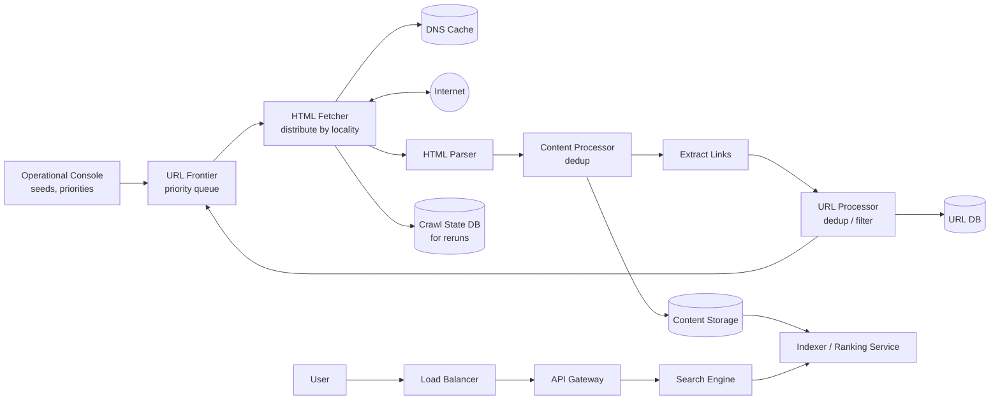

# 06 · Web Crawler + Search Engine

Source: `6_WebCrawler.drawio` and the Web Crawler + Search Engine section of `All.drawio`.

---

## 1. Requirements
### Functional
1. Start from seed URLs, fetch pages, extract links, keep crawling
2. Store page content (title, description, URL, body) as the data source for the search engine
3. Re-crawl pages based on update frequency (freshness)
4. Users search keywords → ranked results

### Non-Functional
1. Scale: ~1B pages/month (~400 pages/s, peak 1k+)
2. **Politeness**: don't overload a host (robots.txt, per-host rate limit)
3. Robustness: bad HTML, traps, timeouts, crashes (resumable)
4. Extensibility: new content types (images, PDFs)
5. Dedup: don't store the same content twice

## 2. Capacity Estimate
- 1B pages × 500 KB ≈ 500 PB/month raw → store compressed text only (~50 KB) ≈ 50 TB/month
- URL frontier: billions of URLs, so it must live on disk with an in-memory head

## 3. High-Level Architecture

### Components
1. **Operational Console**: seed URLs, manual priority overrides, blocklists
2. **URL Frontier (priority queue)**
   - Process by priority based on source, click rate and update frequency
   - Front queues = priority; back queues = one per host (politeness)
3. **HTML Fetcher**
   - Distributed by locality (fetchers close to the target region)
   - Client-side rate limiter per host, short timeouts
   - Respects `robots.txt` (cached)
4. **DNS Cache**: DNS resolution is a bottleneck, so cache it locally
5. **HTML Parser**: validates and parses; extracts title, description, URL
6. **Content Processor (dedup)**: content fingerprint (SimHash / MD5) → skip duplicates
7. **Content Storage**: S3 / Bigtable (compressed)
8. **Extract Links → URL Processor (dedup)**: normalize URLs, filter, check "seen" with a Bloom filter / URL DB
9. **URL DB**: every known URL + last crawl time + priority
10. **Crawl State DB (rerun)**: checkpoints so crashed workers resume
11. **Indexer / Ranking Service**: builds the inverted index and ranking signals
12. **Search path**: User → LB → API Gateway → Search Engine

## 4. Deep Dives
### 4.1 BFS vs DFS
1. **DFS**: goes too deep (spider traps, infinite calendars)
2. **BFS**: standard; but URLs from the same host are grouped together, which could DoS the host → needs per-host politeness queues

### 4.2 Politeness
1. One back queue per host; a single worker per queue
2. Delay between requests to the same host (crawl-delay, or 10× last fetch time)
3. Obey `robots.txt`, `noindex`, `nofollow`
4. Identify with a User-Agent

### 4.3 Freshness / Re-crawl
1. Priority = f(PageRank, change frequency, click rate, source)
2. Use `Last-Modified` / `ETag` with conditional GET
3. Sitemaps

### 4.4 Dedup
1. **URL dedup**: normalization + Bloom filter (false positives = skipped URL, acceptable)
2. **Content dedup**: exact (MD5) + near-duplicate (SimHash / MinHash)

### 4.5 Robustness
1. Spider traps: max depth, max URL length, max pages per host
2. Timeouts and retry with backoff
3. Consistent hashing of hosts → workers; rebalance on failure
4. Checkpoint the frontier (Crawl State DB)

### 4.6 Search Engine
1. **Inverted index**: term → posting list `[(docId, tf, positions)]`, sharded by doc or by term
2. Tokenize, stem, remove stopwords
3. Ranking: TF-IDF / BM25 + PageRank + freshness + click signals
4. Query flow: parse → fan out to index shards → top-K merge → snippets
5. Cache popular queries

## 5. Data Model
- **URL DB**: `urlHash (PK), url, host, priority, lastCrawled, nextCrawl, status`
- **Content**: `urlHash, fingerprint, title, description, body (compressed), fetchedAt`
- **Index**: `term → posting list`

## 6. Monitoring
- Pages fetched/s, error rate by host
- Frontier size, queue age
- Duplicate ratio
- Index freshness lag
