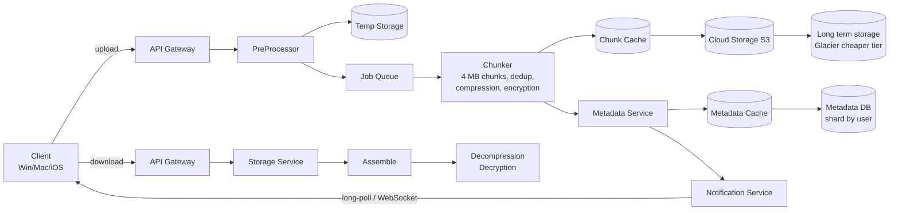

# 07 · Google Drive / Dropbox (Cloud File Storage & Sync)

Source: `7_GoogleDrive.drawio` and the Cloud Storage section of `All.drawio`.

---

## 1. Requirements
### Functional
1. Upload / download files (any size, up to e.g. 50 GB)
2. Sync files across a user's devices (Win/Mac/iOS/Android/Web)
3. File versioning / revision history
4. Share files and folders (view / edit permissions)
5. Notifications of changes

### Non-Functional
1. Reliability / durability: never lose data (11 nines on S3)
2. Fast sync; bandwidth-efficient (send only changed chunks)
3. Scale: ~50M DAU, ~10M concurrent
4. Consistency: a user sees their own latest changes (read-your-writes)
5. Security: encryption in transit and at rest

## 2. Capacity Estimate
- 500M users × 10 GB avg ≈ 5 EB allocated (actual usage is much lower)
- Uploads: 10M/day ≈ 115/s, peak ~500/s

## 3. Two Workflows
1. **Handle upload**
2. **Sync updates**
   1. Remote change (another device changed a file → pull it down)
   2. Local change (file watcher detects an edit → push it up)

## 4. Storage: two kinds of data
1. Raw bytes of the files → **Cloud (blob) storage** (S3), chunked
2. File metadata → **Metadata DB** (sharded by user)

## 5. API
```
POST /files/upload/init     {name, size, chunkHashes[]} -> {fileId, missingChunks[], presignedUrls[]}
PUT  <presigned S3 url>     (chunk bytes)
POST /files/{id}/commit     {version, chunkList}
GET  /files/{id}?version=   -> {chunkList, presignedUrls[]}
GET  /changes?cursor=       -> list of changes since cursor (long poll)
POST /files/{id}/share      {userId, role}
```

## 6. Data Model (Metadata DB, RDBMS, sharded by user)
- **User**: `userId, email, quota`
- **File**: `fileId, ownerId, parentFolderId, name, latestVersion, isDeleted`
- **FileVersion**: `fileId, version, chunkList[], size, createdAt, deviceId`
- **Chunk**: `chunkHash (PK), s3Key, size, refCount`
- **Share/ACL**: `fileId, userId, role`
- **ChangeLog** (per user): `userId, seq, fileId, op, version`

## 7. High-Level Architecture


### Components
1. **Client**
   - File watcher detects local changes
   - Chunk / multipart upload so uploads are resumable
   - Local metadata DB (last synced state)
   - Can assemble chunks client-side
2. **API Gateway**: auth, rate limiting, routing
3. **PreProcessor + Temp Storage + Job Queue**: buffer and async processing
4. **Chunker**
   1. 4 MB chunks / blocks
   2. Deduplication (hash of each chunk)
   3. Compression
   4. Encryption
5. **Chunk Cache / Cloud Storage (S3)**
6. **Metadata Service + Metadata Cache + Metadata DB** (sharded by user)
7. **Notification Service**: long-poll or WebSocket channel for remote changes; sends a notification when metadata is updated (upload completed)
8. **Download path**: Storage Service → Assemble → decompression / decryption
9. **Long-term storage**: cheaper tier (Glacier) for cold / old versions
10. **CDN? No**, because users upload and download their own files (low reuse). Exception: publicly shared files.

## 8. Deep Dives
### 8.1 Enhancements for Large Files (> 10 MB)
1. Upload directly to S3 with **pre-signed URLs** (bypass app servers)
2. Chunk the file
   1. Hash each chunk to compare (**fingerprinting**); upload only missing or changed chunks (delta sync)
   2. Change data capture (**S3 event notification**) → mark the chunk as uploaded → commit metadata
3. Multipart upload with parallel chunks; resume after a failure
4. Content-defined chunking (rolling hash) so an insert doesn't shift every chunk

### 8.2 Sync Protocol
1. Local change: watcher → chunk + hash → `upload/init` → upload missing chunks → `commit(version)`
2. Commit uses **optimistic concurrency**: `UPDATE ... WHERE version = expected`
3. Remote change: Notification Service pushes "changed" → client calls `GET /changes?cursor` → downloads chunks
4. **Change log per user** with a cursor per device

### 8.3 Conflict Policy
1. **LWW (last write wins)**: simple; loses edits
2. **Merge**: for docs (OT / CRDT, as in Google Docs)
3. **Conflicted copy**: keep both (Dropbox's approach)

### 8.4 Dedup
1. Per-user or global chunk dedup by hash (refCount for GC)
2. Global dedup saves storage; has privacy implications (side-channel attacks)

### 8.5 Durability & Cost
1. S3 replication across AZs; cross-region for DR
2. Lifecycle: hot → infrequent access → Glacier for old versions
3. Version retention limits (e.g. 30 days / 100 versions)

### 8.6 Security
1. TLS in transit; AES-256 at rest (KMS)
2. Short-lived pre-signed URLs
3. ACL checks on every metadata access

## 9. Bottlenecks & Trade-offs
- Metadata DB is the hot spot → shard by user, cache, read replicas
- Shared folders cross user shards → separate share index
- Notification fan-out to many devices → WebSocket gateway fleet
- Chunk size: small = better dedup/delta but more metadata; ~4 MB balances both
