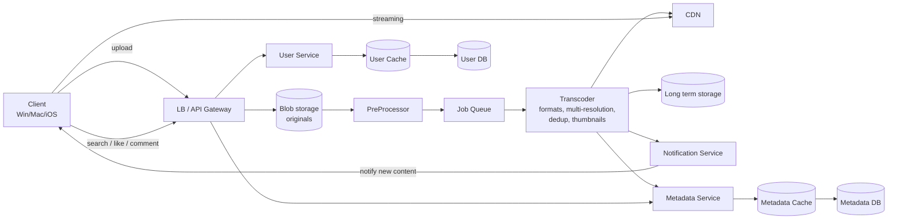

# 08 · YouTube / Netflix (Video Upload & Streaming)

Source: `8_YoutubeNetflix.drawio` and the Video Streaming section of `All.drawio`.

---

## 1. Requirements
### Functional
1. Upload videos
2. Stream / watch videos (adaptive quality)
3. Search videos
4. Like / comment
5. Notify subscribers of new content
6. Thumbnails, view counts

### Non-Functional
1. Highly available; smooth playback (low buffering, fast start < 2 s)
2. Read-heavy (views ≫ uploads, ~200:1)
3. Global low latency (CDN)
4. Durable storage of originals
5. Eventual consistency is fine for views and likes

## 2. Capacity Estimate
- 1B DAU × 5 views = 5B views/day ≈ 60k/s
- 500 hours uploaded/min; ~1 GB/hour after transcoding × ~5 renditions
- Egress bandwidth dominates cost → CDN

## 3. API
```
POST /videos/upload/init {title, size} -> {videoId, presignedUrl(s)}
PUT  <presigned url>                     (multipart upload)
GET  /videos/{id}                        -> metadata + manifest URL (HLS/DASH)
GET  /search?q=&cursor=
POST /videos/{id}/like
POST /videos/{id}/comments {text}
```

## 4. Data Model
- **User** (RDBMS): `userId, name, email`
- **Video metadata**: `videoId, ownerId, title, desc, status(uploading/processing/ready), duration, renditions[], thumbnailUrl, createdAt`
- **Counters**: `videoId → views, likes` (Redis + periodic flush / Cassandra counters)
- **Comments** (Cassandra): `PK(videoId), CK(createdAt desc), commentId, userId, text`
- **Subscriptions**: `userId → channelIds`

## 5. High-Level Architecture


### Components
1. **Client**: adaptive bitrate player (HLS / DASH)
2. **LB / API Gateway**
3. **Blob storage**: originals uploaded through pre-signed URLs
4. **PreProcessor → Job Queue → Transcoder**
   1. Converts to formats optimal for streaming (H.264 / VP9 / AV1; HLS / DASH segments)
   2. Deduplication (fingerprint; content ID / copyright check)
   3. Thumbnail generation
   4. Multi-resolution (240p → 4K)
   5. DAG of tasks: split into segments → parallel encode → merge → package
5. **CDN vs S3**: popular content served from CDN edges; the long tail served from origin (S3)
6. **Long-term storage**: originals + cold renditions
7. **Metadata Service + Cache + DB**
8. **User Service + Cache + DB**
9. **Notification Service**: notifies subscribers when processing finishes

## 6. Deep Dives
### 6.1 Upload Pipeline
1. `upload/init` → pre-signed multipart URLs → resumable upload
2. S3 event → enqueue a transcode job
3. Split the video into GOP-aligned chunks → parallel workers → reassemble
4. Status updates: `uploading → processing → ready`
5. Failure: retry per chunk; DLQ

### 6.2 Streaming
1. **Adaptive bitrate (ABR)**: manifest lists renditions; the player switches based on bandwidth
2. 2–10 s segments; each one is cacheable on the CDN
3. Pre-position popular content in edge caches (Netflix Open Connect)
4. Start fast: low-bitrate first segment

### 6.3 CDN Strategy
1. Popular videos (~20% get ~80% of views) → CDN
2. Long tail → origin / regional caches
3. Signed URLs / tokens for access control and DRM

### 6.4 View Counts & Likes
1. Increment in Redis / Kafka stream → batch aggregate → DB
2. Approximate in real time; exact through batch reconciliation (see [04_TopK](04_TopK_AdClickAggregator.md))

### 6.5 Search
1. Elasticsearch index on title, description, tags; updated asynchronously via CDC from the Metadata DB
2. Ranking by relevance + popularity + personalization

### 6.6 Recommendations (mention)
- Offline candidate generation + online ranking; watch history in a feature store

## 7. Bottlenecks & Trade-offs
- Transcoding cost: transcode popular videos to all renditions, niche videos on demand
- Storage: delete or tier rarely-watched renditions
- Hot videos: CDN absorbs load; the metadata cache needs request coalescing
- Copyright / moderation pipeline adds latency before `ready`
