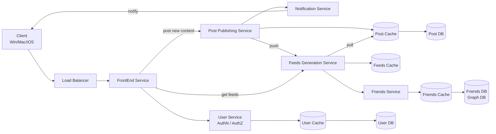

# 09 · News Feed (Post / Feed: Facebook, Twitter, Instagram)

Source: `9_Feed.drawio` and the Post/Feed section of `All.drawio`.

---

## 1. Requirements
### Functional
1. Post new content (text, images, video)
2. Get the news feed: posts from friends / followees, newest or ranked first
3. Follow / friend relationships
4. Notify followers of new posts
5. Like / comment (mention)

### Non-Functional
1. Feed load latency < 200 ms
2. Highly available; eventual consistency is acceptable (a few seconds' delay is OK)
3. Read-heavy (~100:1)
4. Handle celebrities (millions of followers)

## 2. Capacity Estimate
- 500M DAU; each loads the feed 10×/day → ~60k feed reads/s
- 100M posts/day ≈ 1.2k writes/s
- Avg 200 friends → fan-out ~240k feed inserts/s if every post is pushed

## 3. API
```
POST /posts            {content, mediaIds[]}          -> 201 {postId}
GET  /feed?cursor=&limit=20                            -> {posts[], nextCursor}
POST /users/{id}/follow
```

## 4. Data Model
- **User** (RDBMS): `userId, name, …`
- **Post** (Cassandra / sharded MySQL): `postId (Snowflake), authorId, content, mediaUrls, createdAt`
- **Friends / follow graph** (Graph DB or adjacency table): `followerId, followeeId`
- **Feed cache** (Redis list / sorted set): `userId → [postId…]` (bounded to ~500–1000)
- **Media**: S3 + CDN

## 5. High-Level Architecture


### Components
1. **Load Balancer**
2. **FrontEnd Service / API Gateway**
   1. Request validation
   2. TLS termination
   3. Encryption
   4. Rate limiting
   5. Auditing
3. **User Service**: authentication, authorization; User Cache + User DB
4. **Post Publishing Service**: Post Cache + Post DB; media goes to S3/CDN
5. **Feeds Generation Service**: builds and serves feeds; Feeds Cache
6. **Friends Service**: Friends Cache + Friends DB (Graph DB)
7. **Notification Service**: notifies followers (push / in-app)

## 6. Deep Dives
### 6.1 Fan-out Strategies
| | Fan-out on write (**push**) | Fan-out on read (**pull**) |
|---|---|---|
| How | On post, insert postId into every follower's feed cache | On read, fetch recent posts of every followee and merge |
| Read latency | Fast (precomputed) | Slow (N queries + merge) |
| Write cost | High for celebrities | Low |
| Inactive users | Wasted work | No waste |
| Freshness | Immediate | Immediate |

- **Hybrid (recommended)**
  1. Push for normal users (< ~10k followers)
  2. Pull for celebrities: merge their recent posts at read time
  3. Skip pushing to inactive users; build their feed on demand when they return

### 6.2 Feed Generation Flow
1. Post → Post DB/cache → Kafka `post_created`
2. Fan-out workers: get follower list (Friends Service) → `LPUSH`/`ZADD` postId into each feed cache → trim to N
3. Read: feed cache (postIds) → hydrate from Post Cache (multi-get) → merge celebrity posts → rank → return
4. Cursor pagination by `(score/timestamp, postId)`

### 6.3 Ranking
1. Chronological (simple)
2. Ranked: affinity × weight × decay (EdgeRank), or an ML model on engagement features
3. Two-stage: candidate retrieval → ranker

### 6.4 Caching Layers
1. Feed cache (postIds per user)
2. Post cache (content by postId), hot posts replicated
3. Social graph cache
4. Counters cache (likes/comments)
5. CDN for media

### 6.5 Scaling
1. Shard Post DB by postId (or authorId for profile timelines)
2. Shard feed cache by userId
3. Async fan-out with Kafka; prioritize active users
4. Hot posts: local cache + key replication

## 7. Trade-offs & Failure Handling
- Eventual consistency: a post may appear in a feed after a few seconds
- Deleted posts: filter at hydration time (tombstones)
- Privacy changes: check ACL at read time
- Fan-out backlog: monitor queue lag, degrade to pull
