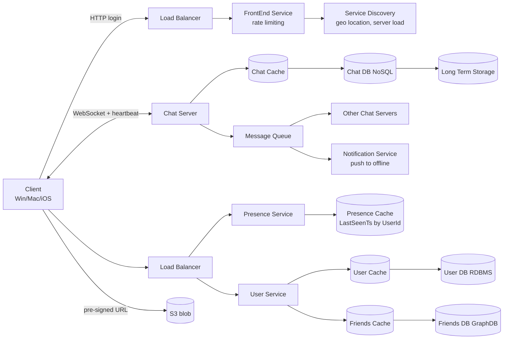

# 10 · Chat System (WhatsApp / Messenger / Slack)

Source: `10_Chat.drawio` and the Chat section of `All.drawio`.

---

## 1. Requirements
### Clarifying Questions
1. Platforms supported? (iOS / Android / Web / Desktop)
2. 1:1 and group chat? Group size limit?
3. Presence status (online / last seen)? Message status (sent / delivered / read)?
4. Scale / volume?
5. Multimedia (images, video, files)?
6. End-to-end encryption? Message retention?

### Functional
1. 1:1 and group chat (e.g. up to 500 members)
2. Online presence + last seen
3. Message status: sent ✓, delivered ✓✓, read
4. Offline messages delivered on reconnect
5. Send / receive media
6. Multi-device sync; chat history

### Non-Functional
1. Real-time, low latency (< 100–200 ms)
2. Ordering within a chat
3. Durability: no message loss
4. High availability
5. R/W ratio: about 1:1 (every message written is read)

## 2. Capacity Estimate
- 500M DAU × 40 msgs = 20B msgs/day ≈ 230k msgs/s
- ~100 B/msg → 2 TB/day
- 50M+ concurrent WebSocket connections → ~50k connections/server → ~1000+ chat servers

## 3. Connection Protocols
| Option | Notes |
|---|---|
| HTTP polling | Wasteful (**bad!**) |
| Long polling | Better, but server must hold connections; reconnect overhead |
| HTTP keep-alive | Reuses the TCP connection; still request/response |
| **WebSocket** | Bi-directional, persistent, no per-browser connection cap; **choose this** |
| SSE (Server-Sent Events) | Uni-directional, max 6 connections per browser (HTTP/1.1) |

- Login / profile / history use plain HTTP; messaging uses WebSocket with a heartbeat

## 4. API
```
WS  connect(token) ; heartbeat every 30s
WS  send {clientMsgId, chatId, content, type}  -> ack {messageId, ts}
WS  <- message {messageId, chatId, senderId, content, ts}
WS  ack {messageId, status: delivered|read}
GET /chats/{chatId}/messages?before=<messageId>&limit=50
POST /media/upload -> presigned URL
```

## 5. Data Model
- **Message** (NoSQL: Cassandra / HBase): `PK(chatId), CK(messageId DESC), senderId, content, type, mediaUrl, createdAt`
  - **Message ID**: sort by reverse chronological order; unique within the chat (Snowflake / per-chat sequence)
- **Chat**: `chatId, type(1:1/group), members[]`
- **User** (RDBMS): `userId, name, …`
- **Friends** (Graph DB)
- **Presence** (Redis): `userId → {status, lastSeenTs, chatServerId}`
- **Offline inbox**: `recipientId, messageId` (pointer list until delivered)

## 6. High-Level Architecture


### Components
1. **Load Balancer + FrontEnd Service**: HTTP APIs, rate limiting
2. **Service Discovery**: picks the best chat server by geographic location and server load (ZooKeeper)
3. **Chat Server**: stateful WebSocket holder; routes messages
4. **Message Queue**: cross-server delivery and fan-out; message prioritization (deprioritize unimportant messages)
5. **Chat Cache + Chat DB (NoSQL) + Long Term Storage**
6. **Presence Service + Presence Cache**: last-seen timestamp by userId
7. **User Service** (User Cache + RDBMS) and **Friends** (Cache + GraphDB)
8. **Notification Service**: mobile push (APNs/FCM) for offline users
9. **Media**: send/receive via pre-signed URL, client ↔ S3 directly

## 7. Deep Dives
### 7.1 Message Flow (1:1)
1. A sends over WS → Chat Server 1 assigns `messageId`, persists, acks A (✓ sent)
2. Looks up B's chat server (session registry in Redis) → MQ → Chat Server 2 → B
3. B acks → status update to A (✓✓ delivered); B opens the chat → read receipt
4. B offline → store in **offline messages inbox** (`recipientId, messageId`) + push notification; deliver on reconnect, then clear

### 7.2 Group Chat
1. Small groups: fan-out on write to each member's inbox / server
2. Large groups / channels: fan-out on read (members pull from the chat's message log)
3. Per-member read cursor (last read messageId) instead of per-message status

### 7.3 Ordering & Dedup
1. Server-assigned monotonic messageId per chat
2. `clientMsgId` for idempotent retries
3. Client sorts by messageId; gap detection → fetch missing

### 7.4 Presence
1. Heartbeat every ~30 s; offline after missing ~2 beats
2. Store `lastSeenTs` in Redis
3. Fan out presence changes only to friends who are online and subscribed (lazy fetch for big lists)

### 7.5 Multi-Device Sync
- Each device keeps a `lastSyncedMessageId` cursor; on reconnect, pull everything newer

### 7.6 Media
1. Client uploads to S3 through a pre-signed URL → sends a message with the mediaUrl
2. Thumbnails generated asynchronously; CDN for downloads

### 7.7 Security
- End-to-end encryption (Signal protocol); the server stores ciphertext only

## 8. Bottlenecks & Trade-offs
- Chat server failure: clients reconnect to another server; in-flight messages are retried via clientMsgId
- Hot group chats: rate limit, fan-out on read
- Storage growth: TTL / move to cold storage
- Cassandra partition size: bucket by `(chatId, month)` for long-lived chats
