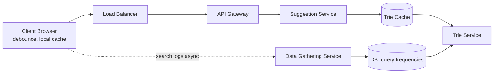

# 11 · Search Autocomplete (Typeahead)

Source: `11_SearchAutoComplete.drawio` and the AutoComplete section of `All.drawio`.

---

## 1. Requirements
### Functional
1. As the user types a prefix, return the top 5–10 suggestions
2. Rank by popularity (search frequency), optionally personalized / trending
3. Support typos (fuzzy match), optional
4. Filter offensive terms

### Non-Functional
1. Very low latency: < 100 ms end to end (users type fast)
2. Highly available
3. Scale: ~10B queries/day; each keystroke is a request
4. Eventual freshness is fine (suggestions refreshed hourly/daily; trending within minutes)

## 2. Capacity Estimate
- 10B searches/day × ~6 keystrokes ≈ 60B requests/day ≈ 700k/s (debounce on the client helps)
- Unique queries ~100M × 30 B ≈ a few GB, so the trie fits in memory per shard

## 3. API
```
GET /suggest?prefix=sys&limit=10&lang=en  -> ["system design", "systemctl", ...]
```

## 4. High-Level Architecture


### Components
1. **Client (browser)**: debounce (~100–200 ms), browser cache of recent prefixes, cancel stale requests
2. **Load Balancer → API Gateway**
3. **Suggestion Service**: reads the top-K for a prefix from the Trie Cache
4. **Trie Cache**: in-memory trie (or prefix → top-K hashmap), sharded and replicated
5. **Trie Service**: builds and serializes the trie from the DB (weekly/daily batch + incremental)
6. **Data Gathering Service** (async): collects search logs → aggregates frequencies
7. **DB**: `query, frequency, window`; serialized trie snapshots

## 5. Deep Dives
### 5.1 Trie Design
1. Each node = a character; terminal nodes store frequency
2. **Cache aggregated top-K at each trie node**, so lookup is O(prefix length), not a subtree traversal
3. Trade-off: more memory and a costlier rebuild, but very fast reads
4. Compress with a radix / Patricia trie

### 5.2 Data Collection & Updates
1. Search logs → Kafka → aggregate (Spark/Flink) by window (weekly + recent)
2. Weighted score: `freq × time-decay`
3. Rebuild offline → swap atomically (blue/green trie)
4. Trending: a separate small real-time trie merged at query time

### 5.3 Sharding
1. By first character(s) of the prefix, with an uneven-distribution fix (split hot letters like "s" into "sa–sm", "sn–sz")
2. Or by hash of the prefix → shard map stored in ZooKeeper
3. Replicas for read throughput

### 5.4 Fuzzy Matching / Typos
1. **Levenshtein distance** search (edit distance ≤ 1–2) over trie branches
2. Symmetric delete / BK-tree
3. Phonetic matching (Soundex)

### 5.5 Alternative: Search Engine
- **Inverted index** with edge n-grams (Elasticsearch `completion` suggester) for full-text and mid-word matches

### 5.6 Caching
1. Browser cache (prefix responses, e.g. 1 h TTL)
2. CDN / edge cache for popular prefixes
3. Redis prefix → top-K cache in front of the trie

### 5.7 Filtering & Personalization
1. Blocklist filter layer before responding
2. Personal history (recent searches) merged with global suggestions
3. Locale/language-specific tries

## 6. Trade-offs
| Decision | Choice |
|---|---|
| Freshness vs cost | Batch rebuild + small real-time trending layer |
| Memory vs latency | Precomputed top-K per node |
| Exact vs fuzzy | Exact prefix by default; fuzzy fallback when results are few |
