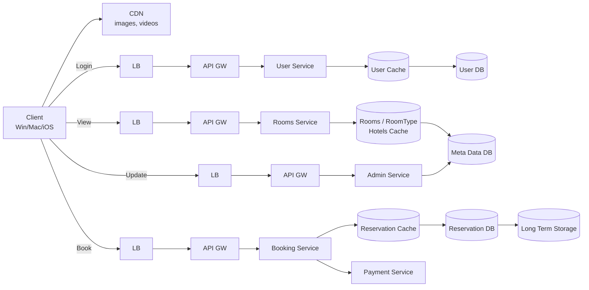

# 12 · Ticket / Hotel Booking (Ticketmaster, Booking.com)

Source: `12_TicketBooking.drawio` and the TicketBooking section of `All.drawio`. The diagram covers hotel rooms and event seats, and the same patterns apply to both.

---

## 1. Requirements
### Functional
1. **View**: search events / hotels, view details, images and videos, availability and price by seat type / room type
2. **Book**: reserve a seat or room, then pay
3. **Update / cancel** a booking
4. **Admin**: manage hotels, rooms and events (update inventory, prices)
5. **Login** / user profile

### Non-Functional
1. **No double booking** (strong consistency on inventory)
2. Low QPS normally; **prepare for traffic spikes** (hot event on-sale)
3. Read-heavy, very few writes (browse ≫ book)
4. Highly available for browsing; consistent for booking
5. Payment is idempotent

## 2. API
```
GET  /events?city=&date=          | GET /hotels?loc=&checkIn=&checkOut=
GET  /events/{id}/seats            | GET /hotels/{id}/rooms?checkIn=&checkOut=
POST /reservations  {itemId, seatIds|roomTypeId, dates}  Idempotency-Key: <uuid>
       -> 201 {reservationId, status: PENDING, holdExpiresAt}
POST /payments      {reservationId, paymentToken}  Idempotency-Key: <uuid>
DELETE /reservations/{id}
```

## 3. Data Model (RDBMS)
- **Hotel / Venue**: `id, name, address, …`
- **RoomType / SeatType**: `id, hotelId, type, price`
- **Room inventory** (per date): `hotelId, roomTypeId, date, totalInventory, totalReserved` + `CHECK (totalReserved <= totalInventory)`
- **Seat** (events): `showId, seatId, seatType, status(AVAILABLE/HELD/BOOKED), heldUntil, version`
- **Reservation**: `reservationId, userId, itemId, status(PENDING/CONFIRMED/CANCELLED/EXPIRED), idempotencyKey UNIQUE, amount`
- **Payment**: `paymentId, reservationId, status, providerRef`

### Why RDBMS
1. ACID compliant: inventory decrements and reservations happen in one transaction
2. Clear relationships (hotel → room type → inventory → reservation)
3. Constraints (unique, check) enforce invariants

## 4. High-Level Architecture


### Components
1. **CDN**: images, videos, static content
2. **User Service**: login, profile; User Cache + User DB
3. **Admin Service**: hotel and room CRUD, pricing
4. **Rooms Service**: browse; Rooms / RoomType / Hotels Cache (read-heavy, very few writes); price by room type
5. **Booking Service**: reservation workflow; Reservation Cache + Reservation DB
6. **Payment Service**: talks to Stripe and similar providers; idempotent
7. **Long-term storage**: archived reservations

## 5. Deep Dives
### 5.1 Mitigate Double Booking (same user clicks twice)
1. **Idempotency key** (client-generated UUID, unique constraint on the reservation)
2. Disable the button client-side (UX only)

### 5.2 Mitigate Booking Race Conditions (two users, one seat)
1. **DB constraint** (vendor specific): `CHECK (totalReserved <= totalInventory)`, unique `(showId, seatId)` on bookings
2. **Locking mechanism**
   - **Pessimistic**: `SELECT … FOR UPDATE`; safe, but contention and deadlocks
   - **Optimistic**: `version` column, `UPDATE … WHERE version = ?`; best under low contention
3. **Distributed lock / seat hold** (Redis `SET seat:{id} user NX PX 600000`): temporary hold during checkout; expires automatically
4. For hot events: **virtual waiting room / queue**, admitting users in batches

### 5.3 Reservation State Machine
`AVAILABLE → HELD (10 min TTL) → PAYMENT_PENDING → CONFIRMED`
- Hold expires → back to `AVAILABLE` (expiry job or Redis TTL + DB sweep)
- Payment failure → release the hold

### 5.4 Cross-Partition Transactions
1. **2-Phase Commit**: needs a coordinator, blocking, very inefficient
2. **Saga**: local transactions + compensating transactions = eventual consistency
   - Reserve seat → charge payment → confirm; on failure: refund → release seat
   - Orchestration (central coordinator) vs choreography (events)
3. **Avoid the need**: shard by `show_id + seat_type` to keep related data in the same partition / instance

### 5.5 Handling Traffic Spikes
1. CDN + caches absorb browse traffic
2. Virtual waiting room (token admission, rate limiting)
3. Autoscale stateless services; pre-scale before announced on-sales
4. Queue booking requests (Kafka) and process sequentially per show partition
5. Bot protection (CAPTCHA, rate limit per user)

### 5.6 Caching Availability
1. Cache availability counts with a short TTL; may be slightly stale
2. **The source of truth at booking time is always the DB**
3. Invalidate / update the cache on reservation events

## 6. Trade-offs
| Decision | Choice | Why |
|---|---|---|
| DB | RDBMS | ACID, constraints, relationships |
| Concurrency | Optimistic normally, hold + queue for hot events | Contention-dependent |
| Distributed txn | Saga over 2PC | Availability, no blocking coordinator |
| Browse consistency | Eventual (cache) | Read-heavy, OK to be slightly stale |
