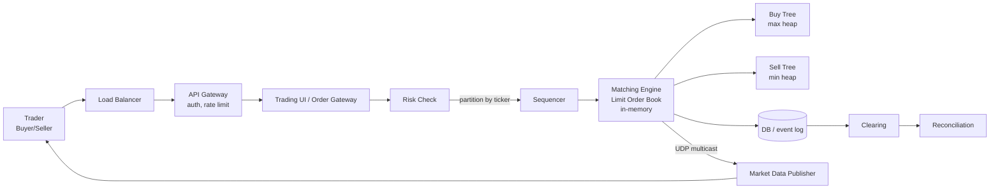

# 13 · Stock Exchange (Order Matching)

Source: `13_StockExchange.drawio` and the Exchange section of `All.drawio`.

---

## 1. Requirements
### Functional
1. Traders (buyers / sellers) place, cancel and modify orders: limit and market
2. Match orders by **price-time priority**
3. Publish market data (order book depth, trades / ticks) in real time
4. Clearing and settlement of executed trades
5. Risk checks (balance, position limits) before orders reach the book

### Non-Functional
1. **Ultra-low latency** (µs–ms matching)
2. Deterministic and fair (strict ordering)
3. Strong consistency: no lost or duplicated fills
4. High availability with fast failover
5. Auditable: every event persisted (regulatory)

## 2. API
```
POST   /orders {clientOrderId, symbol, side(BUY/SELL), type(LIMIT/MARKET), price, qty}
DELETE /orders/{orderId}
GET    /orders/{orderId}
GET    /marketdata/{symbol}/book?depth=10
WS/UDP multicast: market data feed (L1/L2), execution reports
```
(Production exchanges use the FIX protocol over persistent TCP.)

## 3. High-Level Architecture


### Components
1. **Trader → Load Balancer → API Gateway**: auth, rate limiting, validation
2. **Trading UI / Order Gateway**: normalizes orders; assigns order IDs
3. **Risk check**: buying power, position limits, fat-finger checks
4. **Partition by ticker**: each symbol is owned by exactly one matching engine (single-threaded per symbol)
5. **Sequencer**: stamps a monotonic sequence number on every inbound order and outbound event (determinism, replay)
6. **Matching Engine (Limit Order Book)**: in-memory datastore
   - **Buy tree (max heap)**: highest bid first
   - **Sell tree (min heap)**: lowest ask first
7. **DB / event log**: append-only journal of orders and fills
8. **Clearing**: settles trades, updates balances and positions (T+1)
9. **Reconciliation**: end-of-day consistency between the matching log, clearing and bank/custodian
10. **Market data**: **UDP multicasting** to subscribers (fair, simultaneous delivery)

## 4. Deep Dives
### 4.1 Order Book Data Structure
1. Per price level: FIFO queue (doubly linked list) of orders (time priority)
2. Price levels: sorted map / red-black tree, or heaps (best bid = max, best ask = min)
3. `orderId → node` hashmap for O(1) cancel
4. Array indexed by price tick when the price range is bounded (fastest)

### 4.2 Matching Algorithm (price-time priority)
1. New buy limit at P: while best ask ≤ P and qty > 0 → fill against the oldest order at the best ask
2. Remaining qty rests on the buy side
3. Market orders sweep levels until filled
4. Emit execution reports + trade ticks

### 4.3 Determinism & Fault Tolerance
1. Single-threaded matching per symbol: no locks, deterministic
2. **Event sourcing**: the sequenced input log is the source of truth; state = replay(log)
3. Hot standby replicas consume the same sequenced stream (state machine replication) → fast failover
4. Periodic snapshots of the in-memory book to speed up recovery
5. Raft / primary-backup for the sequencer

### 4.4 Latency Optimizations
1. In-memory everything; no DB on the critical path (journal to local disk / mmap asynchronously)
2. Lock-free ring buffers (LMAX Disruptor)
3. Kernel bypass, CPU pinning, avoid GC (or use C++)
4. Co-location; UDP multicast for market data

### 4.5 Market Data
1. L1 (top of book), L2 (depth), L3 (every order)
2. Multicast with sequence numbers; gap → retransmission request
3. Conflation for slow consumers

### 4.6 Clearing & Reconciliation
1. Trades → clearing house → net positions → settlement
2. Reconciliation compares matching-engine fills with clearing and ledger records; flags breaks

## 5. Trade-offs
| Decision | Choice | Why |
|---|---|---|
| Concurrency | Single thread per symbol | Determinism, no locks |
| Persistence | Async journal + replicated log | Latency |
| Scaling | Partition by ticker | Symbols are independent |
| Distribution | UDP multicast | Fairness, low latency |
