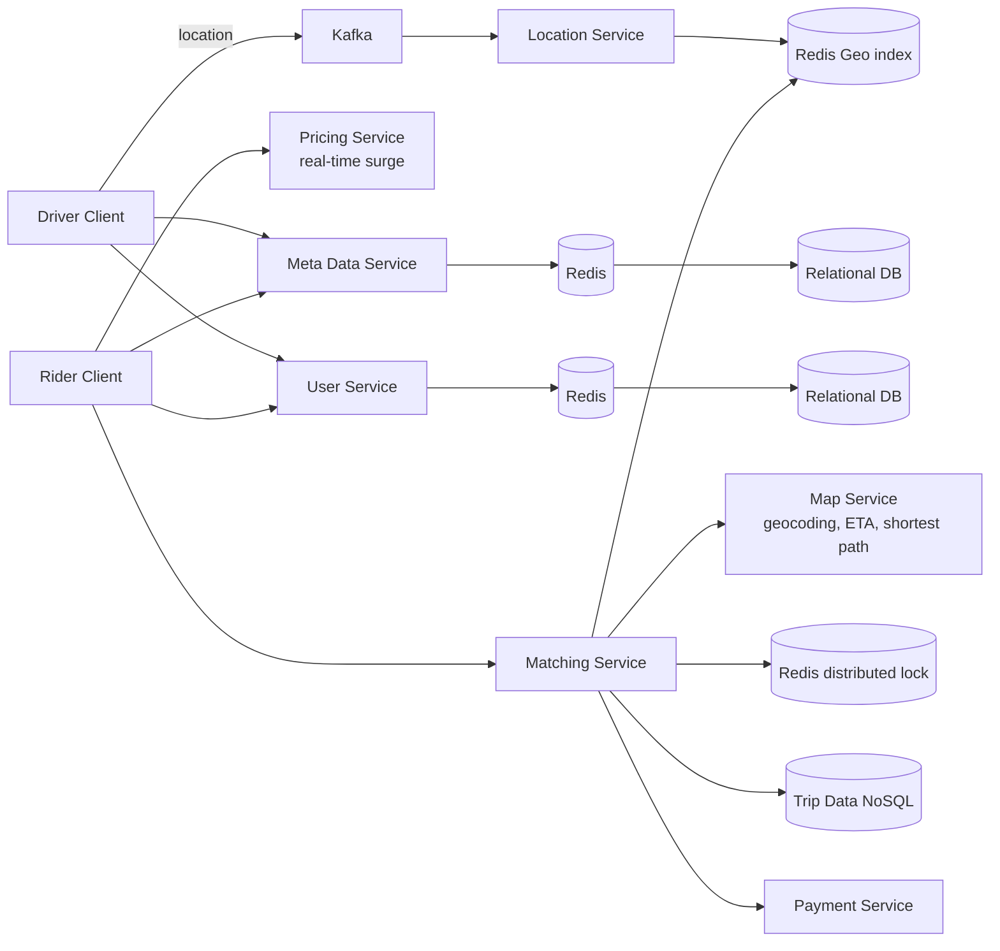

# 14 · Uber / Lyft (Ride Hailing)

Source: `14_UberLyft.drawio` and the Driver section of `All.drawio`.

---

## 1. Requirements
### Functional
1. Rider requests a ride (pickup, destination) → gets a fare estimate
2. Match the rider with a nearby available driver
3. Driver accepts / declines
4. Drivers send location updates every ~4 s; the rider sees the driver in real time
5. Trip lifecycle: requested → matched → en route → in trip → completed → payment
6. Real-time pricing (surge) based on demand
7. Ratings, trip history

### Non-Functional
1. Low matching latency (< 1 min to match, < 1 s per query)
2. **Consistency of matching**: one driver per ride, one ride per driver
3. High availability (especially in-trip)
4. Scale: ~10M drivers online at peak → ~2.5M location updates/s
5. Durability of trip and payment data

## 2. API
```
POST /fare-estimate {pickup, dropoff}             -> {fareId, price, eta}
POST /rides         {fareId}                      -> {rideId, status: MATCHING}
PUT  /drivers/location {lat, lng, ts}             (every ~4s, or WS stream)
POST /rides/{id}/accept | /decline                (driver)
PUT  /rides/{id}/status {ARRIVED|STARTED|COMPLETED}
GET  /rides/{id}                                  (rider polls / WS push)
```

## 3. Data Model
- **User / Driver** (RDBMS + Redis cache): `id, name, vehicle, rating, status`
- **Driver location** (Redis Geo, ephemeral): `driverId → (lat, lng, ts, status)`
- **Ride / trip data** (NoSQL, high write volume): `rideId, riderId, driverId, status, pickup, dropoff, fare, timestamps, route`
- **Fare**: `fareId, riderId, price, surgeMultiplier, expiresAt`
- **Payment** (RDBMS): `paymentId, rideId, amount, status`

## 4. High-Level Architecture


### Components
1. **Driver client / Rider client**: WebSocket for real-time updates
2. **Kafka**: ingests the high-volume location stream
3. **Meta Data Service** (Redis + RDBMS): vehicles, city configs
4. **User Service** (Redis + RDBMS): riders, drivers, auth
5. **Map Service**
   1. Location → coordinate transformation (geocoding)
   2. Geo-based search / geospatial indexing
   3. Shortest / quickest path; ETA
6. **Pricing Service**: real-time pricing based on demand (supply/demand per geo cell)
7. **Matching Service**: finds candidates, ranks them, dispatches the request
8. **Trip data (NoSQL)**
9. **Payment Service**: charges at trip end; idempotent

## 5. Deep Dives
### 5.1 Geospatial Searching & Indexing
1. **Geohashing** (Redis `GEOADD` / `GEOSEARCH`)
   - Encodes lat/lng into a string; shared prefix = nearby
   - Good for even distribution; simple, fast to update
   - Edge cases: search the neighboring cells too
2. **QuadTree** (divide space until each cell holds ≤ k drivers)
   - Good for uneven density (city vs rural)
   - Infrequent updates only (re-indexing is expensive), so it's a poor fit for moving drivers
3. **Google S2 / Uber H3** (hexagons): uniform neighbors, good for surge cells
4. Choice: Redis geo / H3 for live driver locations (frequent updates); QuadTree for static POIs

### 5.2 Location Updates
1. Driver sends every ~4 s → Kafka → Location Service → Redis geo (TTL; drop stale drivers)
2. Partition by city/region
3. Batch and compress on the client; adaptive frequency (slower when idle)

### 5.3 Matching Flow
1. Rider requests → Matching Service queries Redis geo for nearby available drivers
2. Rank by ETA (Map Service), rating, acceptance rate
3. Send the request to the best driver; wait ~10 s → timeout → next driver
4. Driver accepts → atomically mark the driver as busy → ride is MATCHED

### 5.4 Consistency of Rider & Driver Matching
1. No more than one request sent per ride at a time
2. No more than one request received per driver at a time
3. **Distributed lock (Redis)**: `SET driver:{id}:lock rideId NX PX 10000` while the offer is outstanding
4. Durable workflow / queue for matching retries (timeouts, crashes); see Temporal / SQS delay queues

### 5.5 Surge Handling
1. Nodes coordination: matching nodes partitioned by geo cell; the cell owner is found via consistent hashing / ZooKeeper
2. Surge multiplier = f(demand / supply) per cell, recomputed every ~1 min (stream processing)
3. Queue ride requests during spikes; scale the matching service per region

### 5.6 Failure Handling
1. Driver app disconnects mid-trip: the trip continues; reconcile on reconnect
2. Matching service crash: the request is in a durable queue → another worker resumes
3. Payment failures: retry + idempotency key

## 6. Trade-offs
| Decision | Choice | Why |
|---|---|---|
| Location index | Redis geohash / H3 | High update rate |
| Location ingest | Kafka | Buffering, fan-out to analytics |
| Matching consistency | Distributed lock + TTL | Prevents double dispatch |
| Trip storage | NoSQL | Write volume, simple access by rideId |
| Payments | RDBMS | ACID |
