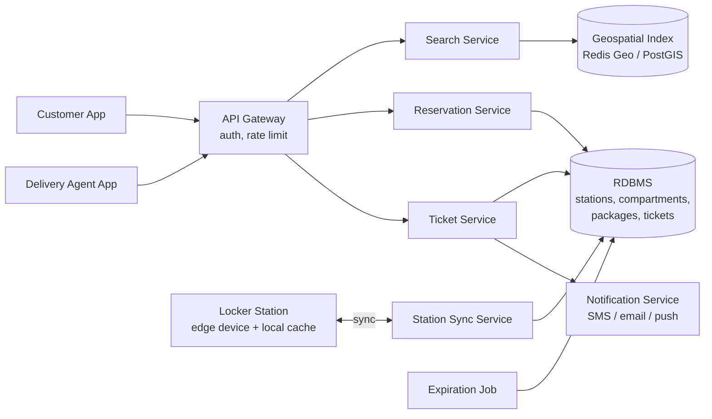

# 15 · Amazon Locker

Source: the Amazon Locker section of `All.drawio`. (`15_AmazonLocker.drawio` is currently a copy of the Uber diagram.)

---

## 1. Requirements
### Functional
1. Search available (closest) locker stations that meet criteria (location, package size, hours)
2. **Drop-off**: delivery agent places the package → system assigns a compartment → customer gets a pickup code
3. **Pick-up**: customer enters the code at the station → compartment opens
4. Expiration: package returned if not picked up within N days (e.g. 3)
5. Customer returns via locker (optional)

### Non-Functional
1. **No double allocation** of a compartment (strong consistency)
2. Station works through **network interruptions** (offline mode)
3. Secure: codes can't be guessed; fraud prevention
4. Low-latency search (< 200 ms)
5. Scale: ~100k stations × ~50 compartments

## 2. Entities
1. **LockerStation**: `id, locName, zip, lat, lng, size, availableSize(per size), hoursOfOperation`
2. **LockerCompartment**: `lockerCompartmentId, lockerStationId, size(S/M/L), status(AVAILABLE/RESERVED/OCCUPIED/OUT_OF_SERVICE)`
3. **Package**: `id, orderId, userId, compartmentId, size, status(IN_TRANSIT/DELIVERED/PICKED_UP/RETURNED)`
4. **Ticket** (pickup code): `ticketId, packageId, codeHash, issueTs, expiresIn, isActive`
5. **User**: `id, username, password(hash)`

## 3. API
```
GET  /stations?lat=&lng=&radius=&size=M             -> stations with availability
POST /reservations {orderId, stationId, size}       -> {compartmentId, reservationId}   (at checkout)
POST /dropoff      {packageId, stationId}  (agent)  -> {compartmentId} ; issues ticket, notifies user
POST /pickup       {stationId, code}                -> {compartmentId to open}
POST /tickets/{id}/resend
```

## 4. High-Level Architecture


### Components
1. **Search Service**: geospatial index of stations + cached availability counts
2. **Reservation Service**: allocates compartments transactionally
3. **Ticket Service**: generates one-time codes (random, hashed at rest), validates and expires them
4. **Notification Service**: sends the pickup code and reminders
5. **Locker Station edge device**: local cache of active tickets; opens compartments; queues events while offline
6. **Station Sync Service**: two-way sync (tickets down, events up)
7. **Expiration Job**: flags expired packages for return and frees compartments

## 5. Challenges & Solutions
### 5.1 Concurrency / Race Conditions on Compartment Allocation
1. Database transaction (ACID-compliant DB):
   ```sql
   UPDATE locker_compartment SET status='RESERVED', package_id=?
   WHERE id = (SELECT id FROM locker_compartment
               WHERE station_id=? AND size=? AND status='AVAILABLE'
               LIMIT 1 FOR UPDATE SKIP LOCKED)
   ```
2. Implement a lock (row lock / optimistic `version` / Redis lock per station)
3. Fall back to the next size up if no fitting compartment is free

### 5.2 Network Interruptions at the Locker Station
1. Edge caching: the station keeps the active ticket list (hashed codes) locally
2. Validate the code locally and open the compartment
3. Queue pickup/drop-off events; sync when back online (idempotent event IDs)
4. Reservations made centrally while the station is offline are synced later; keep a buffer of compartments

### 5.3 Security / Fraud
1. Rate limiting on code attempts per station (lockout after N failures)
2. MFA (multi-factor auth) for high-value packages or agent login
3. Long random codes, single use, expire on pickup
4. Camera / audit logs for compartment opens

### 5.4 Search
1. Geospatial index (geohash / PostGIS / Redis `GEOSEARCH`)
2. Filter by available size + operating hours
3. Cache availability per station (short TTL); confirm at reservation

## 6. Workflows
1. **Checkout**: user picks a station → reserve a compartment of the right size (hold until delivery date)
2. **Drop-off**: agent scans the package → station opens the reserved compartment → status OCCUPIED → ticket issued → notify the user
3. **Pick-up**: user enters the code → validated (locally or centrally) → compartment opens → package PICKED_UP → compartment AVAILABLE
4. **Expire**: after N days → notify → return pickup → compartment freed

## 7. Trade-offs
| Decision | Choice | Why |
|---|---|---|
| DB | RDBMS | Inventory invariants, transactions |
| Allocation | `FOR UPDATE SKIP LOCKED` | No contention between concurrent allocators |
| Offline | Edge validation | Station availability over central consistency |
| Search freshness | Cached counts | Read-heavy; confirm at write time |
