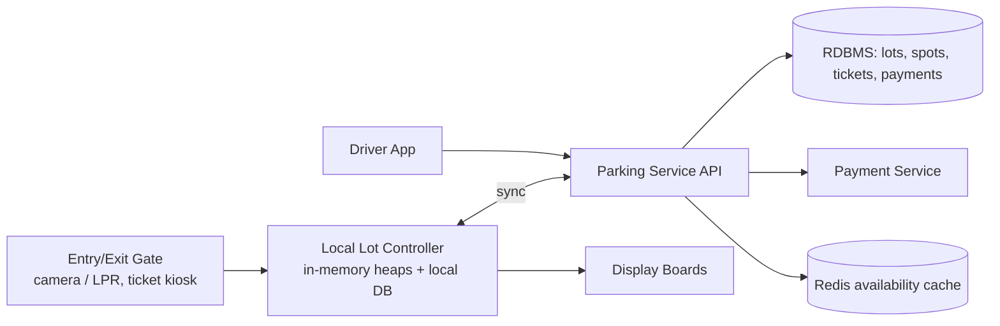

# 16 · Parking Lot

Source: the Parking Lot section of `All.drawio` and `2026Q3Notes.drawio`. This design works as both an OOD (low-level design) answer and a system design answer.

---

## 1. Requirements
### Functional
1. Search for the available (closest) parking spot that fits the vehicle
2. Allocate a parking spot and generate a ticket at entry
3. Look up the parking spot by ticket
4. Look up the ticket / parking spot by license plate
5. Un-allocate the parking spot at checkout; compute the fee and take payment
6. Multiple entries/exits, multiple levels; spot sizes (motorcycle / compact / large / EV)
7. Show availability per level on display boards

### Non-Functional
1. No two vehicles assigned the same spot (concurrency-safe)
2. Fast entry/exit (< 1 s allocation)
3. Works when the network is down (local gate controller)
4. Accurate billing; idempotent payments

## 2. Entities
1. **ParkingLot**: `id, loc, levels[], numOfSpots, entryList[], exitList[]`
2. **ParkingEntry / Exit**: `id, loc (coordinates on the level)`
3. **ParkingLevel**: `levelId, spots[]`
4. **ParkingSpot**: `id, levelId, enum vSize (S/M/L), isEV, status (FREE/OCCUPIED/OUT_OF_SERVICE)`
5. **Ticket**: `ticketId, licensePlate, spotId, entryTs, exitTs, amount, status`
6. **Vehicle / CarModel**: `licensePlate, enum make, enum model, enum vSize`
7. **Payment**: `paymentId, ticketId, amount, method, status`
8. **PricingStrategy**: hourly / flat / by size (Strategy pattern)

## 3. Data Structures
1. **PriorityQueue (min heap)** of free spots keyed by distance from the entry
2. **HashMap** for quick lookups:
   - `ticketId → Ticket`
   - `licensePlate → Ticket`
   - `spotId → ParkingSpot`
3. **Lock on entry/leave** (mutex per heap / per spot size)

### Find the Closest Parking Spot from an Entry
1. One min heap **per entry** (and per vehicle size): distance from that entry to each free spot
2. Enter: `poll()` the closest free spot, O(log n)
3. Leave: push the spot back into **every** entry's heap, O(E · log n)
4. Lazy deletion: when a spot is taken via entry A, it's still in B's heap → on `poll()`, skip spots that are no longer FREE
5. Alternative: an ordered set (TreeSet) per entry gives O(log n) removal without lazy deletion

## 4. API (system design view)
```
POST /entry   {lotId, entryId, licensePlate, vSize}  -> {ticketId, spotId, level}
GET  /tickets/{ticketId}                              -> ticket + spot
GET  /tickets?licensePlate=ABC123                     -> active ticket + spot
POST /exit    {ticketId}                              -> {amount}
POST /payments {ticketId, method}  Idempotency-Key    -> {status}
GET  /lots/{id}/availability                          -> per level / per size counts
```

## 5. Class Design (OOD)
```
ParkingLot (Singleton per lot)
 ├─ List<Level> levels
 ├─ List<Entry> entries   ─ each Entry owns Map<VSize, PriorityQueue<SpotDist>>
 ├─ Map<String, Ticket> ticketsById
 ├─ Map<String, Ticket> ticketsByPlate
 ├─ assignSpot(vehicle, entry) : Ticket      // synchronized / lock per size
 ├─ releaseSpot(ticket)       : void
 └─ PricingStrategy pricing  ─ HourlyPricing | FlatPricing | SizeBasedPricing
Spot { id, level, vSize, status, canFit(vehicle) }
Ticket { id, plate, spot, entryTs, exitTs, calcFee(pricing) }
```
- Patterns: Singleton (lot), Strategy (pricing, spot selection), Factory (vehicle/spot types), Observer (display boards)

## 6. High-Level Architecture (multi-lot system)


## 7. Deep Dives
### 7.1 Concurrency
1. Lock on entry/leave (per lot, or per vehicle size for less contention)
2. DB: `UPDATE spot SET status='OCCUPIED' WHERE id=? AND status='FREE'` (conditional update / optimistic)
3. One ticket per plate: unique index on `(licensePlate) WHERE status='ACTIVE'`

### 7.2 Fee Calculation
- `fee = pricing.calc(vSize, exitTs - entryTs)`, rounded up to the hour; lost ticket → look up by plate (LPR camera)

### 7.3 Retry Strategy (payments / sync)
1. Retry transient failures
2. **Exponential backoff**
3. **Jitter**
4. Idempotency key on payment calls

### 7.4 Offline Mode
- The local controller owns allocation for its lot; syncs tickets and payments to the cloud when the network returns

## 8. Trade-offs
| Decision | Choice | Why |
|---|---|---|
| Closest spot | Min heap per entry | O(log n) allocation |
| Removal across heaps | Lazy deletion | Simple; heaps lack O(log n) arbitrary removal |
| Consistency | Local controller is authoritative per lot | Gate must work offline |
| Storage | RDBMS | Small scale, transactional |
